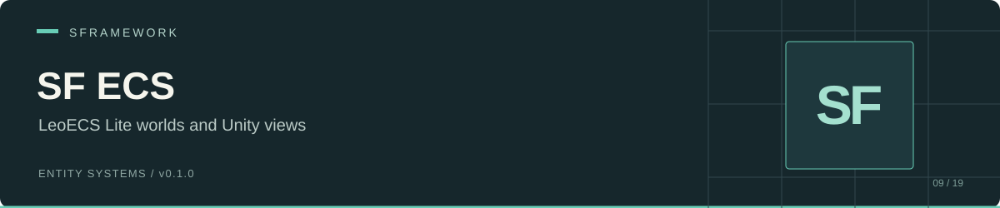

# SF ECS

Unity authoring components, GameObject-to-entity mapping, and a worlds service for **LeoECS Lite** in SFramework.

 

[Install](#installation) · [Authoring](#component-authoring) · [Lifecycle](#entity-lifecycle) · [API](#public-api) · [Limits](#known-limits)

## Compatibility checkpoint

This package and the checked `sf-core/main` sources do not currently share the same API:

- [SFECSSystem](Runtime/SFECSSystem.cs) requires `ISFContainer`, which the checked SF Core sources do not define.
- The [component generator](Editor/SFComponentsGenerator.cs) requires `SFCoreSettings._assetPath` and `GeneratorScriptsPath`, which the checked SF Core sources do not define.
- [SFWorldsService](Runtime/SFWorldsService.cs) lacks `Init(CancellationToken)` and `Dispose()`, both required by the checked `ISFService` interface.

Align the Core API before treating the setup below as a working Unity installation. This README does not identify a compatible historical revision.

SF ECS and [SF ECS Odin](https://github.com/huran438/sf-ecs-odin) declare the same runtime/editor assembly names and many of the same types. Choose one Lite integration per project.

## Installation

Add this Git URL through Unity Package Manager's **Add package from git URL**:

```text
https://github.com/huran438/sf-ecs.git#main
```

The package ID is `sp.sframework.ecs`. [package.json](package.json) declares version `0.1.0`; it contains no dependency entries or minimum Unity version.

Supply the assemblies below before using the package. The manifest does not install them for you.

| Required assembly | Source / use |
| --- | --- |
| `SFramework.Core.Runtime` | [SF Core](https://github.com/huran438/sf-core); injection, views, and service contracts. Resolve the API differences above. |
| `SFramework.Core.Editor` | SF Core editor utilities and tool integration. |
| `Leopotam.EcsLite` | A compatible LeoECS Lite installation; worlds, pools, packed entities, and systems. |

See the [runtime](Runtime/SFramework.ECS.Runtime.asmdef) and [editor](Editor/SFramework.ECS.Editor.asmdef) assembly definitions for the exact references. This is a Lite package; Proto types do not satisfy these references.

## Component authoring

`SFComponent<T>` copies serialized inspector data into an ECS pool when an `SFEntity` activates. Implement `ISFComponent` to identify your data as an SF component; the generic base itself accepts any struct.

Save this example as `HealthAuthoring.cs` in your project:

```csharp
using System;
using SFramework.ECS.Runtime;
using UnityEngine;

namespace Example.Ecs
{
    [Serializable]
    public struct Health : ISFComponent, IEcsAutoInit<Health>
    {
        public int Current;

        public void AutoInit(ref Health component)
        {
            component.Current = Mathf.Max(1, component.Current);
        }
    }

    [DisallowMultipleComponent]
    [RequireComponent(typeof(SFEntity))]
    public sealed class HealthAuthoring : SFComponent<Health>
    {
    }
}
```

Add `HealthAuthoring` to a GameObject and set its data in the inspector. Your Core bootstrap must supply `ISFWorldsService` before `SFView` injects and initializes the entity.

`IEcsAutoInit<T>.AutoInit(ref T)` runs before the provider adds its value to the pool. `SFComponent<T>.Value` returns the serialized authoring value by reference. Changing that value after activation does not update the existing ECS component.

### Generated providers

As an alternative to a handwritten provider, place `[SFGenerateComponent]` on a struct. The editor generator emits `SFramework.Generated._YourStruct`, adds an `SFComponents/…` menu entry, and requires `SFEntity` on its GameObject.

The generator scans on editor load and writes to the directory configured by `SFCoreSettings.GeneratorScriptsPath`. It skips existing files unless you use **Edit → SFramework → Generate ECS Scripts**, which forces regeneration. Resolve the settings API mismatch before using this path.

Attach one provider per component type. The provider calls `EcsPool<T>.Add`, so duplicate setup for the same type does not use the package's `Replace` helper.

## Entity lifecycle


[SFEntity](Runtime/SFEntity.cs) discovers `ISFEntitySetup` components during its first `Init()` and activates once. Activation adds `GameObjectRef` and `TransformRef` before running your providers.

Call `Deactivate()` to delete the entity and disable its GameObject. Call `Activate()` after initialization to create a new entity and enable the GameObject. Repeated activation while active returns without creating a second entity. `OnDestroy()` calls `Deactivate()`.

Disabling the GameObject alone does not invoke ECS deletion in this variant. The component has no `OnDisable` handler. Do not call `Activate()` before Core injection and component discovery.

## Accessing live data

Use mapping to retrieve the owning world as well as the entity ID. This helper updates the live component rather than the inspector copy:

```csharp
using SFramework.ECS.Runtime;
using UnityEngine;

namespace Example.Ecs
{
    public static class HealthAccess
    {
        public static bool SetHealth(GameObject target, int value)
        {
            if (target == null ||
                !SFEntityMapping.GetEntity(target, out var world, out var entity))
                return false;

            ref var health = ref world.GetPool<Health>().Replace(entity);
            health.Current = Mathf.Max(1, value);
            return true;
        }
    }
}
```

`Replace<T>` returns the existing component by reference or adds one if absent. It does not clear an existing value.

## Worlds and systems

`SFWorldsService` constructs `Default` and stores it under `Guid.Empty`. `GetWorld(guid)` falls back to that dictionary entry for an unknown key. `SFEntity` always creates its entity in `Default`; it exposes no world selector.

The service contains no `EcsSystems` pipeline or Unity update callback. Your host owns system construction, initialization, ticking, and destruction.

`SFECSSystem` implements Lite initialization and run interfaces. During `Init`, it obtains an `ISFContainer` from the systems' shared data, injects itself, and calls `Setup(IEcsSystems, ISFContainer)`. During `Run`, it calls `Tick(ref IEcsSystems)`. That shared-container contract needs a matching Core implementation.

## Public API

| API | Behavior |
| --- | --- |
| [`ISFWorldsService`](Runtime/ISFWorldsService.cs) | `Default`, `GetWorld(Guid)`, `CreateWorld(out Guid, bool)`, `DestroyWorld(Guid)`, `ResetDefaultWorld()`. See world-management limits below. |
| [`SFEntity`](Runtime/SFEntity.cs) | `EcsPackedEntity`, `Activate()`, `Deactivate()`. |
| [`SFComponent<T>`](Runtime/SFComponent.cs) | Serialized `Value` by reference and `Setup(ref EcsPackedEntityWithWorld)`. |
| [`ISFEntitySetup`](Runtime/ISFEntitySetup.cs) | Custom authoring hook during entity creation. |
| [`SFEntityMapping`](Runtime/SFEntityMapping.cs) | `GetEntity` with or without world, `GetEntityPacked`, and `Clear()`. |
| [`SFExtensions.Replace<T>`](Runtime/SFExtensions.cs) | Get-or-add operation returning a component reference. |
| [`GameObjectRef`](Runtime/GameObjectRef.cs), [`TransformRef`](Runtime/TransformRef.cs) | Unity object references added by `SFEntity`. |
| [`SFGenerateComponentAttribute`](Runtime/SFGenerateComponentAttribute.cs) | Editor provider generation for structs. |

`GetEntityPacked` checks the mapping entry, not packed-entity validity. Call `Unpack` before using a stored handle. `Clear()` removes mappings without deleting ECS entities.

## Known limits

| Symptom / constraint | Source-backed explanation |
| --- | --- |
| Compilation fails with current SF Core | Resolve the missing container/settings symbols and service lifecycle methods listed above. |
| Creating another world disrupts default lookup | `CreateWorld` uses `new Guid()`, which equals `Guid.Empty`, and overwrites the default dictionary entry. Avoid this API until corrected. |
| Default lookup returns a destroyed world after reset | `ResetDefaultWorld` replaces `Default` but does not update the dictionary entry for `Guid.Empty`. |
| `started` does not control execution | The service stores state flags but contains no start/stop or ticking logic. `DestroyWorld(Guid.Empty)` returns without destroying anything. |
| Mapping lookup receives a null GameObject | This variant calls `GetInstanceID()` without a null guard; check your input. |
| Inspector changes do not affect an active entity | Providers copy their authoring data during `Setup`; edit the live pool for runtime changes. |

## Validation and related packages

This README describes source at commit [`0f1f528`](https://github.com/huran438/sf-ecs/commit/0f1f5289bcdd3234626de84ff7d77fb4846b6a04). The examples received static source review only. No Unity compilation, Play Mode, player build, or automated test execution accompanied this documentation. The package declares no minimum Unity version.

- [SF Core](https://github.com/huran438/sf-core): dependency injection and view lifecycle.
- [SF ECS Odin](https://github.com/huran438/sf-ecs-odin): an alternative Lite integration with configured worlds and Odin authoring.
- [SF ECS Proto](https://github.com/huran438/sf-ecs-proto): a separate LeoECS Proto integration.
- [SF ECS Tween](https://github.com/huran438/sf-ecs-tween): tween data and interpolation helpers for Lite.

## License

[MIT](LICENSE.md). Consult each dependency's own license.
